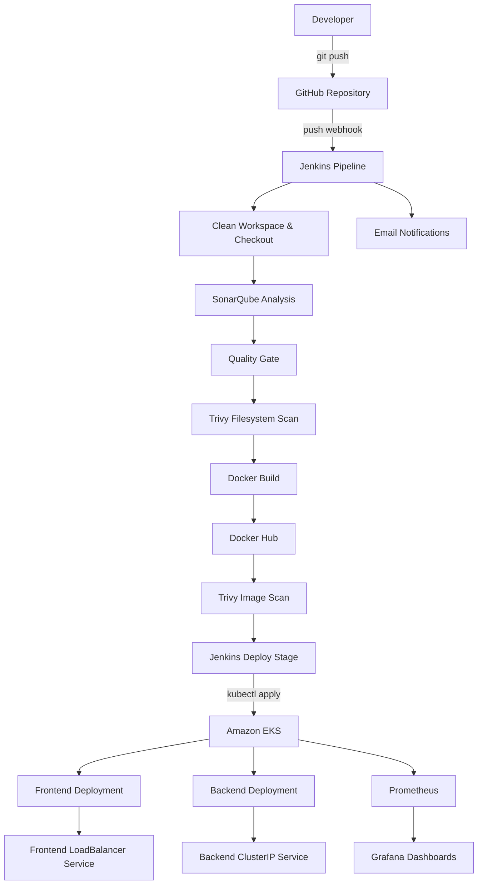

# End-to-End DevSecOps CI/CD Pipeline on AWS

A practical DevSecOps implementation that automates source control integration, code-quality analysis, vulnerability scanning, container image delivery, Kubernetes deployment, monitoring, and build notifications.

The pipeline was demonstrated using **AstroHunt** as its sample application. The workflow is designed around reusable DevOps practices and can be adapted to other containerized applications by changing the source repository, image names, build commands, and Kubernetes manifests.

> **Project emphasis:** secure and repeatable software delivery, not just running a Jenkins job. The pipeline connects GitHub, Jenkins, SonarQube, Trivy, Docker Hub, Amazon EKS, Prometheus, Grafana, and email notifications.

---

## Table of contents

- [Project goals](#project-goals)
- [Architecture](#architecture)
- [Technology stack](#technology-stack)
- [End-to-end pipeline](#end-to-end-pipeline)
- [Infrastructure design](#infrastructure-design)
- [Jenkins configuration](#jenkins-configuration)
- [Pipeline stages in detail](#pipeline-stages-in-detail)
- [Container image workflow](#container-image-workflow)
- [Amazon EKS deployment](#amazon-eks-deployment)
- [Monitoring and observability](#monitoring-and-observability)
- [Recreate the environment](#recreate-the-environment)
- [Verification and troubleshooting](#verification-and-troubleshooting)
- [Security practices](#security-practices)
- [Cost control and cleanup](#cost-control-and-cleanup)
- [Demo evidence](#demo-evidence)

---

## Project goals

This project demonstrates how to build a delivery workflow that:

1. Starts automatically when code is pushed to GitHub.
2. Checks code quality with SonarQube.
3. Scans the source workspace and built container images with Trivy.
4. Builds and publishes Docker images to Docker Hub.
5. Deploys application workloads to Amazon EKS using Kubernetes manifests.
6. Collects Kubernetes and node metrics with Prometheus and visualizes them in Grafana.
7. Sends pipeline status notifications by email.
8. Uses infrastructure automation for the supporting AWS compute environment.

### What this project demonstrates

- CI/CD orchestration with Jenkins and GitHub webhooks.
- Static analysis and quality-gate integration.
- Filesystem and container-image vulnerability scanning.
- Docker image build, tagging, registry authentication, and publishing.
- Kubernetes Deployments, Services, replicas, and rollout verification.
- EKS access configuration and Jenkins-to-cluster authentication.
- Metrics collection and dashboards for cluster observability.
- Troubleshooting real deployment failures across Git, Docker, Jenkins, IAM, DNS, Kubernetes, and Nginx.

---

## Architecture



### Request path

- The frontend is served by Nginx on container port `80` and exposed using a Kubernetes `LoadBalancer` Service.
- The backend runs FastAPI/Uvicorn on container port `8000` and is exposed internally using a Kubernetes `ClusterIP` Service.
- Prometheus and Grafana run inside the EKS cluster in a dedicated `prometheus` namespace.
- Jenkins connects to EKS using a Kubernetes kubeconfig credential and an AWS identity authorized for the target cluster.

**Frontend/backend routing note:** Kubernetes DNS names such as `astrohunt-backend-service` are only resolvable inside the cluster. Browser JavaScript cannot call a ClusterIP service directly. A same-origin Nginx `/api` reverse proxy, Ingress, or another secured API entry point is needed for browser-to-backend traffic. The Nginx SPA fallback is for frontend routes and is not, by itself, an API reverse proxy.

---

## Technology stack

| Area | Technology | Purpose |
|---|---|---|
| Source control | Git, GitHub | Version control and source repository |
| Trigger | GitHub Webhooks | Notify Jenkins on repository pushes |
| CI/CD | Jenkins | Automate build, scan, publish, deploy, and notifications |
| Code quality | SonarQube | Static analysis and Quality Gate evaluation |
| Security scanning | Trivy | Filesystem and container-image scanning |
| Containers | Docker | Package application components into images |
| Image registry | Docker Hub | Store and distribute container images |
| Infrastructure as Code | Terraform | Provision supporting AWS infrastructure such as EC2 and security groups |
| Kubernetes provisioning | eksctl | Create and manage the EKS cluster used in the demonstration |
| Orchestration | Amazon EKS, Kubernetes | Run application workloads and Services |
| Metrics | Prometheus | Scrape and store metrics |
| Dashboards | Grafana | Visualize infrastructure and Kubernetes metrics |
| Cluster metrics | Node Exporter, kube-state-metrics | Expose node and Kubernetes object metrics |
| Notifications | Jenkins Email Extension / SMTP | Send build and deployment status emails |

**Provisioning distinction:** Terraform was used for the supporting EC2 environment. The demonstration EKS cluster was created with `eksctl`. The application workloads were deployed with Kubernetes YAML manifests. Do not describe the EKS cluster itself as Terraform-provisioned unless Terraform EKS resources are added to the infrastructure code.

---

## End-to-end pipeline

```text
Developer Push
      |
      v
GitHub Webhook
      |
      v
Jenkins Pipeline
      |
      +--> Clean Workspace
      |
      +--> Checkout Source
      |
      +--> SonarQube Analysis
      |
      +--> Quality Gate
      |
      +--> Trivy Filesystem Scan
      |
      +--> Docker Build & Push
      |
      +--> Trivy Image Scan
      |
      +--> Deploy to Amazon EKS
      |
      +--> Email Notification
```

The stages are intended to make feedback available throughout delivery: source quality and security checks happen before deployment, while deployment and rollout checks verify the Kubernetes release.

---

## Infrastructure design

### Supporting EC2 environment

An EC2 instance was used to host the CI tools, including Jenkins, SonarQube, Docker, and Trivy. A separate monitoring EC2 environment was also used during the project for monitoring-related services and access.

Terraform was used to automate supporting AWS infrastructure such as:

- EC2 instance provisioning.
- Security group configuration.
- Region and provider configuration.
- Instance bootstrap through a user-data installation script.

Example Terraform lifecycle:

```bash
terraform init
terraform fmt
terraform validate
terraform plan
terraform apply
```

Review the plan before applying it. Do not commit state files, private keys, access keys, or secret variables.

### Amazon EKS environment

The demonstration cluster was created with `eksctl`, using three `t2.small` worker nodes in `ap-south-1`:

```bash
eksctl create cluster \
  --name <cluster-name> \
  --region ap-south-1 \
  --node-type t2.small \
  --nodes 3
```

Configure the local or management-host kubeconfig:

```bash
aws eks update-kubeconfig \
  --region ap-south-1 \
  --name <cluster-name>
```

Verify cluster connectivity:

```bash
kubectl cluster-info
kubectl get nodes -o wide
```

The cluster name is intentionally shown as a placeholder. Use the name created in your own AWS account.

---

## Jenkins configuration

### Jenkins plugins and integrations

The Jenkins environment used these integrations (plugin names can vary slightly by plugin release):

- Pipeline
- Git and GitHub integration
- SonarQube Scanner for Jenkins
- Docker Pipeline / Docker-related pipeline support
- Kubernetes CLI (`kubeconfig` integration)
- Credentials Binding
- Email Extension
- Workspace Cleanup

Install plugins from **Manage Jenkins → Plugins** and restart Jenkins when the plugin installation requires it.

### Global tools

Configure the tools under **Manage Jenkins → Tools**:

- JDK installation used by the SonarQube analysis stage (the project used JDK 21).
- SonarQube Scanner installation.

### SonarQube server configuration

Under **Manage Jenkins → System → SonarQube installations**, configure a server entry such as:

- Name: `SonarQube-Server`
- Server URL: the reachable SonarQube URL from the Jenkins host
- Authentication: a SonarQube token stored in Jenkins Credentials

Do not place the token directly in the Jenkinsfile.

### Jenkins credentials

Create credentials in **Manage Jenkins → Credentials**. The pipeline used credential IDs similar to:

| Credential ID | Credential purpose | Recommended storage |
|---|---|---|
| `dockerhub` | Docker Hub login | Username/password credential with an access token as the password |
| `SonarQube-Token` | SonarQube authentication | Secret text |
| `kubernetes` | Kubeconfig for EKS deployment | Secret file |

The Jenkins host also needs an AWS IAM identity authorized to authenticate to the target EKS cluster. A kubeconfig file alone does not grant AWS permissions. When an EKS cluster is recreated, refresh the kubeconfig and update the Jenkins Secret file credential; keep the credential ID used by the pipeline consistent.

### GitHub webhook trigger

Configure the GitHub repository webhook to point to the Jenkins webhook endpoint:

```text
http://<jenkins-host>:8080/github-webhook/
```

In the Jenkins pipeline job, enable **GitHub hook trigger for GITScm polling**. Use HTTPS, a webhook secret, and restricted Jenkins access for a production deployment. A successful webhook delivery means GitHub reached Jenkins; verify that a new Jenkins build actually starts.

---

## Pipeline stages in detail

### 1. Clean Workspace

The pipeline removes stale files from the previous run so that a build uses a clean workspace.

Typical Jenkins step:

```groovy
cleanWs()
```

### 2. Checkout from Git

Jenkins checks out the configured GitHub repository and branch. This makes each pipeline run traceable to a repository revision.

### 3. SonarQube Analysis

The SonarQube Scanner analyzes the checked-out source code and uploads the analysis report to the configured SonarQube server.

The results can include:

- Bugs and reliability issues.
- Vulnerabilities and security hotspots.
- Code smells and maintainability issues.
- Duplication metrics.

Coverage results require a coverage report to be generated and supplied to SonarQube; running a scanner alone does not create test coverage.

### 4. Quality Gate

Jenkins waits for SonarQube's Quality Gate result. This provides a quality checkpoint before later stages.

**Policy note:** if the pipeline uses `waitForQualityGate(abortPipeline: false)`, an unsuccessful Quality Gate is reported but does not abort the pipeline. Set `abortPipeline: true` when the desired policy is to block subsequent stages on a failed gate.

### 5. Trivy Filesystem Scan

Trivy scans the source workspace for supported vulnerabilities, misconfigurations, secrets, and related findings depending on the scan options and configuration.

The pipeline can preserve the output as a report file for review and email attachment.

### 6. Docker Build and Push

The frontend and backend are built separately using their Dockerfiles and pushed to Docker Hub.

Images used by the Kubernetes manifests:

```text
<dockerhub-username>/astrohunt-frontend:latest
<dockerhub-username>/astrohunt-backend:latest
```

The pipeline authenticates using a Jenkins credential rather than a hard-coded token.

### 7. Trivy Image Scan

Trivy scans the built container images for operating-system and language-package vulnerabilities. The report can be retained as a build artifact or attached to the notification email.

**Policy note:** the demonstration pipeline used `--exit-code 0` for image scanning. This allows the stage to complete while reporting findings; it does not enforce a vulnerability-based deployment block. For stricter enforcement, define severity thresholds and a non-zero exit code after reviewing and tuning the policy.

### 8. Deploy to Kubernetes / Amazon EKS

Jenkins uses the Kubernetes kubeconfig credential and runs commands such as:

```bash
kubectl get nodes
kubectl apply -f deployment.yml
kubectl apply -f service.yml
kubectl get deployments
kubectl get pods -o wide
kubectl get services
```

The pipeline also checks application rollout status:

```bash
kubectl rollout status deployment/astrohunt-frontend --timeout=180s
kubectl rollout status deployment/astrohunt-backend --timeout=180s
```

### 9. Post-build actions and email

The post-build section uses Jenkins Email Extension to send build status notifications. The configured message can include the console log and Trivy reports.

Use an SMTP app password or dedicated mail credential stored in Jenkins Credentials. Never store an email password in the pipeline source.

---

## Container image workflow

Build commands should be run from the repository root so the Docker build context matches the `COPY` paths in the Dockerfiles.

### Frontend image

```bash
docker build \
  -f frontend/frontend/Dockerfile \
  -t <dockerhub-username>/astrohunt-frontend:<tag> \
  .
```

The frontend Dockerfile:

1. Uses Node.js to install dependencies and build the Vite application.
2. Copies the production build into an Nginx image.
3. Copies the custom Nginx configuration into the image.
4. Serves the static frontend on port `80`.

The Nginx configuration includes SPA fallback routing:

```nginx
location / {
    try_files $uri $uri/ /index.html;
}
```

### Backend image

```bash
docker build \
  -f backend/backend/Dockerfile \
  -t <dockerhub-username>/astrohunt-backend:<tag> \
  .
```

The backend image uses Python 3.11, installs the packages in `backend/requirements.txt`, and starts the FastAPI application with Uvicorn on port `8000`.

### Recommended image tagging

The demonstration used the `latest` tag. For stronger traceability, publish an immutable tag as well, for example:

```text
astrohunt-frontend:<git-commit-sha>
astrohunt-backend:<git-commit-sha>
```

Update the Kubernetes deployment to reference that exact tag. This makes it easier to identify which source revision is running in the cluster.

---

## Amazon EKS deployment

The Kubernetes manifests are stored in the `Kubernetes/` directory.

### Deploy the application

From the repository root, after configuring access to the target EKS cluster:

```bash
kubectl apply -f Kubernetes/deployment.yml
kubectl apply -f Kubernetes/service.yml
```

### Workload layout

| Resource | Type | Replicas / Port |
|---|---|---|
| `astrohunt-frontend` | Deployment | 2 replicas, container port 80 |
| `astrohunt-backend` | Deployment | 2 replicas, container port 8000 |
| `astrohunt-frontend-service` | LoadBalancer Service | External port 80 → target port 80 |
| `astrohunt-backend-service` | ClusterIP Service | Internal port 8000 → target port 8000 |

### Verify the deployment

```bash
kubectl get nodes -o wide
kubectl get deployments
kubectl get pods -o wide
kubectl get services
kubectl get endpoints
```

Wait for the frontend AWS LoadBalancer hostname:

```bash
kubectl get svc astrohunt-frontend-service --watch
```

Retrieve the hostname:

```bash
kubectl get svc astrohunt-frontend-service \
  -o jsonpath='{.status.loadBalancer.ingress[0].hostname}'
```

Open the resulting hostname using HTTP for the demonstration. The DNS name can change when the Service or cluster is recreated.

### Backend connectivity check

The backend Service is internal to the cluster. A temporary curl pod can test Kubernetes DNS and the FastAPI docs route:

```bash
kubectl run backend-test \
  --rm -i \
  --restart=Never \
  --image=curlimages/curl \
  -- curl -i http://astrohunt-backend-service:8000/docs
```

A `200 OK` response indicates that the in-cluster request reached FastAPI and returned the docs page.

---

## Monitoring and observability

The project uses the Prometheus Community `kube-prometheus-stack` Helm chart in the `prometheus` namespace.

### Install the monitoring stack

```bash
helm repo add prometheus-community \
  https://prometheus-community.github.io/helm-charts

helm repo update

kubectl create namespace prometheus

helm upgrade --install stable \
  prometheus-community/kube-prometheus-stack \
  --namespace prometheus
```

The chart installs or configures components including:

- **Prometheus:** scrapes and stores time-series metrics.
- **Grafana:** visualizes metrics in dashboards.
- **Alertmanager:** handles alert routing and grouping when alert rules are configured.
- **Prometheus Operator:** manages Prometheus-related Kubernetes resources.
- **Node Exporter:** exposes host-level metrics from worker nodes.
- **kube-state-metrics:** exposes metrics about Kubernetes objects.

Check the release and components:

```bash
helm list -n prometheus
kubectl get pods -n prometheus
kubectl get svc -n prometheus
```

### Grafana credentials

Get the generated Grafana admin password:

```bash
kubectl get secret stable-grafana \
  --namespace prometheus \
  -o jsonpath="{.data.admin-password}" | base64 --decode
echo
```

The chart's default admin username is `admin`. Store the password securely.

### Access with port forwarding

Grafana:

```bash
kubectl port-forward -n prometheus svc/stable-grafana 3000:80
```

Prometheus:

```bash
kubectl port-forward -n prometheus \
  svc/stable-kube-prometheus-sta-prometheus 9090:9090
```

For a remote EC2 management host, use an SSH tunnel from your workstation to the EC2 host and browse to `http://localhost:3000` and `http://localhost:9090`. Keep the port-forward processes running while using the dashboards. Do not expose monitoring endpoints publicly without appropriate authentication and network restrictions.

### Dashboards used during the demonstration

| Dashboard ID | Purpose |
|---|---|
| `1860` | Node Exporter Full |
| `9964` | Jenkins monitoring (requires Jenkins metrics to be scraped) |
| `15760` | Kubernetes Pods |
| `17119` | Kubernetes EKS Cluster |

Dashboard panels depend on installed exporters, scrape configuration, data-source selection, and the labels expected by each dashboard.

---

## Recreate the environment

A typical recreation sequence is:

1. Provision or start the management EC2 host.
2. Ensure AWS CLI, `eksctl`, `kubectl`, Helm, and Docker are available.
3. Verify the AWS identity with `aws sts get-caller-identity`.
4. Create the EKS cluster using `eksctl` or the infrastructure configuration maintained for the environment.
5. Update kubeconfig using `aws eks update-kubeconfig`.
6. Verify that the worker nodes are `Ready`.
7. Install Prometheus/Grafana with Helm.
8. Ensure the frontend and backend images exist in Docker Hub.
9. Deploy the Kubernetes manifests.
10. Update Jenkins' Kubernetes Secret file credential with the new cluster kubeconfig and verify the Jenkins AWS identity has access to the new cluster.
11. Trigger a GitHub push and verify the complete pipeline.

**Important:** a newly created EKS cluster has a different API endpoint and certificate. The Jenkins kubeconfig credential must be updated after cluster recreation. Jenkins also needs an AWS IAM identity and EKS access entry/RBAC mapping authorized for the new cluster.

---

## Verification and troubleshooting

### Useful Kubernetes commands

```bash
kubectl cluster-info
kubectl get nodes -o wide
kubectl get deployments
kubectl get pods -A -o wide
kubectl get svc -A
kubectl get endpoints -A
kubectl describe deployment astrohunt-frontend
kubectl logs deployment/astrohunt-frontend --tail=100
kubectl logs deployment/astrohunt-backend --tail=100
```

### Common issues encountered

| Symptom | Likely area to inspect |
|---|---|
| Git push rejected (`fetch first`) | Fetch remote commits, then use `git pull --rebase origin main`; resolve conflicts before pushing. |
| Docker `COPY` source not found | Confirm repository-root build context and source paths. Docker resolves `COPY` paths relative to the build context, not the Dockerfile directory. |
| TypeScript build fails | Inspect the reported source file and line; fix the compile error before building the image. |
| Nginx returns 404 on a frontend route | Verify the SPA fallback configuration and that the React route exists. |
| `kubectl` uses an old EKS endpoint | Regenerate kubeconfig for the new cluster and update the Jenkins Secret file credential. |
| Jenkins cannot resolve the EKS endpoint | Check that its kubeconfig points to the current cluster and that DNS/network connectivity is working. |
| Jenkins reports Unauthorized / AccessDenied | Verify the Jenkins AWS identity, EKS access entry, Kubernetes authorization, and IAM permissions. |
| Pods are not Ready | Inspect `kubectl describe pod`, container logs, image names/tags, resource limits, and application configuration. |
| Frontend loads but API requests fail | Check the browser Network tab, frontend API base URL, and the public API reverse-proxy/Ingress route. |
| LoadBalancer hostname is pending | Inspect the Service events and AWS networking prerequisites, including subnets and IAM permissions. |

---

## Security practices

- Never commit AWS access keys, secret access keys, IAM credentials, SonarQube tokens, Docker Hub tokens, Gmail app passwords, kubeconfig files, or application secrets.
- Store CI/CD secrets in Jenkins Credentials or a dedicated secrets manager.
- Prefer IAM roles and least-privilege policies over long-lived IAM user access keys.
- Restrict Jenkins, SonarQube, Grafana, and Prometheus to trusted networks. Use HTTPS for externally accessible services.
- Rotate credentials immediately if they are exposed in chat, source control, screenshots, logs, terminal recordings, or video demonstrations.
- Use immutable image tags for release traceability.
- Review Trivy findings and SonarQube Quality Gate results before promoting images to deployment.
- Treat scan success and scan enforcement separately: a scan configured with `--exit-code 0` can report vulnerabilities without failing the build.
- Do not grant broad administrator permissions to Jenkins or application workloads when narrower IAM policies are sufficient.

---

## Cost control and cleanup

AWS resources created for this project can incur charges even when the application is not receiving traffic. Potentially billable resources include EKS control planes, worker EC2 instances, EBS volumes, LoadBalancers, NAT Gateways, public IPv4 addresses, snapshots, and data transfer.

When the demonstration is finished:

1. Remove Kubernetes Services of type `LoadBalancer` and any externally provisioned Ingress resources.
2. Delete the EKS cluster and its managed node groups using the same tool/configuration used to create them.
3. Check EC2 for leftover instances and unattached EBS volumes.
4. Check for NAT Gateways, Elastic IP addresses, snapshots, and other resources that may continue billing.
5. Stop or terminate the separate Jenkins/monitoring EC2 instances depending on whether they need to be preserved. Stopped EC2 instances can still incur EBS storage and other applicable charges.
6. Review AWS Billing and Cost Explorer after cleanup.

Example for an `eksctl`-created cluster:

```bash
eksctl delete cluster \
  --name <cluster-name> \
  --region ap-south-1
```

Stopping the management EC2 host does **not** stop the separately managed EKS control plane or worker nodes. Verify cleanup in the AWS Console rather than assuming one command removed every billable resource.

---

## Demo evidence

Add links to the recorded walkthrough and screenshots when they are published:

- **Project demo video:** _Add YouTube link_
- **Architecture diagram:** _Add image path or link_
- **Pipeline screenshots:** _Add screenshot links_
- **Grafana dashboards:** _Add screenshots or exported dashboard links_

---

## Acknowledgements

Built as a hands-on project to practise cloud infrastructure, CI/CD automation, software supply-chain security, containerization, Kubernetes orchestration, and observability.
